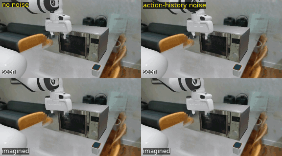

# WAM kitchen

The continuation of [microwave-from-human-video](https://github.com/HanshangZhu/microwave-from-human-video).

The aim was to train a world model's video head on human egocentric video and to use the digital twin only to test it.
**That has not been done yet.** So far, what works is the conventional route: a pretrained world-action model
(LingBot-VA) is post-trained on scripted demonstrations in the twin until it solves the task in closed loop (71 of 72
held-out starts). This README covers:
- what was done;
- why the human video is not used yet;
- what comes next.

## What this repository is now

- **A working recipe** for fine-tuning a pretrained world-action base model on simulator demonstrations, and the
  diagnostics of what the model learned. The results are below; the full log is in `wam/EXPERIMENTS.md`.
- **Not evidence that human video helps.** The ego takes were used once, as video-only training samples, and no gain
  was shown.

## Why the human video is not used yet

**What we have.** 49 egocentric RealSense takes of one person doing this one task in one kitchen: 11.9 minutes in total,
median 14 s per take. 43 of them were used in training, as video clips without actions.

**Two ways human video reaches robot actions, and where 12 minutes stands in each.**
- **Without explicit alignment** (human data as one more embodiment, or as pre-training), transfer has been reported only
  at large scale:
  - **PI** ([Kareer et al. 2025](https://arxiv.org/abs/2512.22414)): with about 14 h of human data, transfer appears only
    once the *robot* pre-training is diverse enough. There was no gain at 0-25 % of their pre-training mixture, and gains
    at 75-100 % (e.g. Spice 32 -> 71 %).
  - **Dyna-2** ([Dyna Robotics, Aug 2026](https://dyna.co/dyna-2)), pre-trained on human video only:
    - from 1k to 1M hours, zero-shot action error on robot data falls from 0.180 to 0.117, and the mean on-robot score
      after post-training rises from 20 to 53 %, with an "inflection" between 10k and 100k hours;
    - even at 1M hours, zero-shot accuracy on robot data is 0.159, against 0.47 on held-out human data;
    - it is a company report, with one run per data size and compute held fixed.
  - Twelve minutes is several orders of magnitude below either.
- **With explicit alignment,** minutes can be enough.
  - **HumanEgo** ([Wang et al. 2026](https://arxiv.org/abs/2605.24934)) uses no robot data.
    - Hand poses from stereo glasses are retargeted to a virtual parallel gripper, and the policy reads an
      interaction-centric representation of hands and objects.
    - With about 30 min of human video per task it reaches 92.5 % over four tasks, and 75 % at 15 min. A teleoperation
      baseline trained on 30 min reaches 51.2 %.
    - It rests on that engineering: raw RGB gives 7.5 % where the representation gives 85 % on one task, and swapping
      the hand tracker takes one task from 95 to 0 %.
  - Our 12 minutes are in this range, but this route needs accurate 3D hand tracking, and our takes were never used this
    way.

**Why not as action labels here.** In the twin a scripted solver gives unlimited, exact robot demonstrations. In the first
project, human motion used as action labels lost to that oracle: 59 % vs 88 % at matched demonstration counts. So in
simulation the human data is not needed for actions. What it can add is how real objects and rooms look and move, or
supervision for tasks without an oracle.

**What our one co-training run shows, and what it does not.** With 30 % of the samples from the ego takes, the model
reached 11/24 against 16/24 without them (p = 0.27). Three explanations remain open:
- too little video;
- video-only samples, so no supervision of actions;
- an unmatched comparison: an earlier checkpoint, no lr decay and about 30 % fewer robot updates.

On the held-out ego video, the robot-only model drifts from the base (validation loss 0.240 -> 0.410). With 30 % ego
video the loss stays near the base for 14000 steps, but keeps rising.

## Plan and status

| step | what | status |
|---|---|---|
| 0 | object-centric world model on the first project's three takes (state: pot pose and door angle; action: wrist pose), evaluated against the twin's object states | not started |
| 1 | ego-video capture at scale (head-mounted RealSense or phone), with wrist and hand tracking | not started; 49 takes (12 min) exist |
| 2 | world-model video head trained on the captures; prediction quality vs horizon | not started (needs 1) |
| 2a | LingBot-VA (Wan2.2 5B) LoRA post-trained on twin demonstrations rendered over the room splat; the ego takes once as video-only samples | **working: 71/72 held-out starts** ([Results](#results-step-2a)); no gain shown from the ego video |
| 3 | improve the policy beyond demonstrations: RL in the twin, where success is measurable and the solver can label states | planned |
| 4 | whole-body G1 in Isaac Lab on an existing whole-body controller | planned |

**How human data could re-enter**, in order of what 12 minutes can support:
1. **Aligned supervision on this task, HumanEgo-style.** Track the hands in the takes and retarget them to gripper actions.
   This is worth trying only where no scripted oracle exists, e.g. real-robot data.
2. **As a prior for step 3.**
   - Human motion as targets that seed RL. Dyna-2.1 reports faster convergence of its RL controller from human-pose
     targets, qualitatively and without numbers.
   - A learned world model as the place where the policy trains. SuperMimic
     ([Liao et al., CoRL 2026](https://arxiv.org/abs/2610.28480)) fits a differentiable world model in the loop and uses
     analytic gradients, and reports more than 1000x fewer GPU-hours for humanoid motion tracking. Its gains come from the
     model and the gradients, not from a warm start.
3. **At scale (step 1).** This is the regime where unaligned transfer has been reported.

The notes behind this section are in `wam/literature/human_ego_transfer.md`.

## Results (step 2a)

**Task.** In the twin, a Franka arm opens the microwave, puts the pot inside and closes the door.
- **Success:** the pot is inside and the door is shut.
- **Starts:** the pot's start position is drawn from the range of the demonstrations. Starts 0..7 were used to pick
  checkpoints; starts 8..79 never were.
- **Observation:** only the front camera (160 x 288, from a held-out take's registered pose), with the room splat behind
  the scene.
- **Execution:** the model is queried every 32 simulator steps (4 latent frames), and its predicted end-effector pose is
  executed by IK. Episodes stop at 1500 steps.

**Model.** `lingbot-va-base` with:
- LoRA rank 128;
- the pre-training action layout (end-effector pose, joints, gripper);
- attention over the whole episode in half of the samples.

**Data.** 260 solver demonstrations, 7 of them held out for validation:
- whole task: 59, plus 20 with DART noise;
- starts in the middle of the task: 76;
- recovery from a failed place: 46;
- recovery from a missed door handle: 59.

**Noise on the action history.** In half of the training samples, the past actions the model attends to are mixed with
Gaussian noise (`train_va.py --action-noisy-cond-p 0.5`).
- The level is drawn per frame between 0 and 50 %, 25 % on average.
- LingBot-VA's recipe already does this, more strongly, for the past video.

**Training.** 14000 steps at lr 1e-4, then continued to 20000 with the lr falling linearly to 1e-5: 59 h on one RTX 5090.

| model (one machine, the same starts for every row) | starts 8..31 | starts 32..79 | all 72 held-out starts |
|---|---|---|---|
| **the model above, 20000 steps** | 24/24 | 47/48 | **71/72 (99 %, 95 % CI 93-100)** |
| the same at 12000 steps (constant lr; picked on starts 0..7) | 16/24 | 39/48 | 55/72 (76 %, 65-85) |
| the same data without the action-history noise (best of 7 checkpoints) | 5/24 | | |
| with the noise, plus the ego takes as 30 % of samples (best of 7) | 11/24 | | |
| earlier best: slower demonstrations, a wrist camera, pot-grasp retry demos, no noise, 20000 steps (111 h), queried every 8 steps | 14/24 | 29/48 | 43/72 (60 %, 48-70) |

Before these: zero-shot 0/21; the first post-trained models 0-1 of 8.

*Start 25, with the same data and settings, without and with the action-history noise. The checkpoints were picked by
the rule: 8000 vs 12000 steps. Each column shows the camera above the model's imagination, at 2× speed. Without the
noise the arm never grasps the pot and goes on to close the door. More GIFs are in `wam/EXPERIMENTS.md`: the hand-over
rescue and the planned door miss.*

What the comparisons show (paired by start, exact McNemar):

- **The action-history noise is what made the policy work.**
  - 16/24 with it, 5/24 without, everything else identical: 13 starts solved only with it, 2 only without (p = 0.007).
  - Without it, 18 of the 19 failures are missed pot grasps, while the door, which never moves, is still opened.
  - Swapping what the model has in its context on held-out demonstrations (`reliance_va.py`) shows why. Without the
    noise, replacing the past actions moves the predicted arm motion 2-3x more than replacing the past video (21-35 cm
    vs 8-10 cm). With the noise, the two are about equal (15-26 vs 17-21 cm).
  - The model without it continues its own trajectory instead of looking where the pot is. This is the "copycat" failure
    of imitation from histories (de Haan et al. 2019; Wen et al. 2020), and the remedy is the same as ChauffeurNet's
    past-motion dropout (Bansal et al. 2019, also in half of the samples).
- **Longer training with a falling lr** took the same recipe from 76 % to 99 %: 17 starts gained, 1 lost (p = 0.0001).
  Steps and lr schedule changed together.
- **The ego video did not help here:** 11/24 with it against 16/24 without (p = 0.27), from one unmatched run (see above).
- **Rates from 24 starts do not rank models.** The same weights on the same 24 starts gave 19/24 on one machine and 14/24
  on another: the machines differ numerically in the last digits, and closed-loop rollouts amplify that. Results here are
  therefore over 72 starts and compared on one machine.

Not shown yet:
- the final model on the second machine;
- a second training seed;
- steps vs lr decay, separately;
- anything outside this task, scene and camera.

The experiments still to run, with their cost, are in `wam/NEXT_STEPS.md`.

## Contents

- `wam/`: the LingBot-VA work (step 2a).
  - `render_va.py` renders solver demonstrations from a take's camera over the room splat.
  - `encode_va.py` encodes robot runs and ego takes to VAE latents.
  - `train_va.py` is the LoRA post-training (`--action-noisy-cond-p`, `--lr-end`, `--chunk-max`).
  - `eval_va.py` is the closed loop in the twin (`--chunk`: latent frames per query).
  - `handover_va.py`: one model drives until its grasp fails, then another takes over.
  - `average_lora.py` averages a run's checkpoints.
  - Diagnostics:
    - `imagine_va.py` and `prefix_va.py`: imagined video from a start or a demonstration prefix;
    - `action_acc_va.py`: action error with the true history;
    - `reliance_va.py`: how much the actions follow the action history vs the video;
    - `head_consistency_va.py`: agreement of the pose and joint outputs.
- `wam/EXPERIMENTS.md`: the log of the LingBot-VA work. It covers the setup, every run by what it changed, results with
  their tests, what did not work, and limitations. GIFs are in `wam/media/`.
- `wam/NEXT_STEPS.md`: the experiments still to run, what each answers and its cost in GPU-hours.
- `wam/literature/`: notes on:
  - noise on the action history;
  - teaching recovery without imitating failures;
  - forgetting;
  - regularising toward the base model;
  - human egocentric data and robot actions.
- `sim/`, `assets/`, `recon/gs_server.py`, `recon/gs_kitchen.py`: the twin, the scripted solver and demonstration
  generator, and the splat renderer.
  - These were copied from the first repository on 18 October 2026 and developed here since (the solver's `--smooth`,
    `--miss-back`, `--speed`).

Registration and per-frame object extraction stay in the first repository. The room splat and the takes are recordings
of my home and are shared on request (zcabhz4@ucl.ac.uk). Scripts expect them, and all generated data, under
`Gitignore-but-important/` (not in git).

*Started 17 October 2026.*
